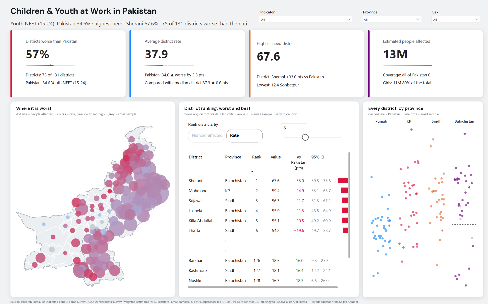
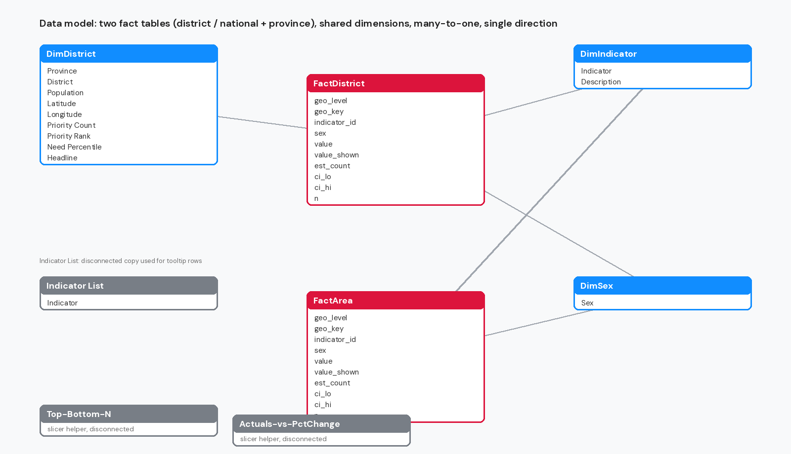

# Children & Youth at Work in Pakistan: district dashboard (Power BI)

Where are children out of school, teenagers working, and young people neither working nor studying? This Power BI report maps ten child and youth indicators across Pakistan's 131 districts, using survey-weighted estimates from the Pakistan Bureau of Statistics **Labour Force Survey 2020-21**.



**[Full report as PDF](https://github.com/danyalkhattak-git/pakistan-district-youth-powerbi/blob/c3acf24ccc17119bbefd334c6ae5830dce256fb9/lfs-district-dashboard.pdf)**  ·  Power BI file: [`LFS District Dashboard.pbix`](https://github.com/danyalkhattak-git/pakistan-district-youth-powerbi/blob/a6d5b3b71eadebb5e9cdb7f5798508cfe63f1cea/pakistan-district-youth-powerbi.pbix)  ·  template: [`LFS District Dashboard.pbit`](LFS%20District%20Dashboard.pbit)

## What's in it

**Page 1: Overview**
- A headline sentence that rewrites itself for the chosen indicator, province and sex
- Four KPI cards: districts worse than the national rate, average district rate, highest-need district, estimated people affected (each with an SVG progress bar driven by DAX)
- District dot map: dots placed at district coordinates over a district-boundary background, sized by people affected and coloured by rate
- Worst / best N district ranking with gap to Pakistan, 95% confidence interval and a diverging bar
- Every district by province: jitter plot per province with the national rate as a reference line

**Page 2: Priority districts**
- Every district × every indicator, each cell shaded by the district's national percentile; districts sorted by how many indicators put them in the worst quarter nationally
- Largest girls-boys gaps for the chosen indicator
- Priority districts per province

**District profile tooltip**
- Hover a district anywhere in the report to see the selected indicator with its confidence interval and sample size, its priority count and rank, and all ten indicators against its province and Pakistan

 

## Indicators

| Code | Indicator | Age |
|---|---|---|
| C1, C2 | Out of school | 10-14, 15-17 |
| L1, L2 | Working | 10-14, 15-17 |
| L3 | Working and out of school | 10-17 |
| Y1 | Not in employment, education or training (NEET) | 15-24 |
| Y2 | Youth unemployment (ILO definition) | 15-24 |
| W1 | Female labour force participation | 15-64 |
| G1, G2 | Girls-minus-boys gap in NEET and in out-of-school | |

## Method

- **Source:** PBS Labour Force Survey 2020-21 microdata, estimated at district level.
- **Estimates:** weighted with the survey expansion weights; standard errors are linearised, with enumeration blocks (EBCode) as primary sampling units and districts as strata.
- **Small samples:** estimates based on fewer than 50 respondents are suppressed. Those based on fewer than 100, or with a 95% confidence interval wider than ±10 points, are flagged "use with caution". They are shown in grey on the map, as pale dots on the province plots and with an amber CI in the ranking.
- **Need direction:** for female labour force participation, lower is worse; for every other indicator, higher is worse. Rankings, colours and "worse than Pakistan" all follow this direction.
- **Priority districts:** a district is a priority on an indicator if it is in the worst quarter of districts nationally (both sexes). The priority count is the number of indicators, out of ten, on which this holds.
- **Not covered:** Gilgit-Baltistan, AJK and Islamabad, which have no district estimates in this release. The former FATA districts are included within Khyber Pakhtunkhwa.

Data preparation (Python): [`pakistan-youth-dashboard/prep`](https://github.com/danyalkhattak-git/pakistan-youth-dashboard).

## Data model



Two fact tables (district rows; national and province rows) share dimension tables for district, indicator and sex. Disconnected helper tables drive the Top N, ranking-basis and tooltip-row selections. All measures are listed in [`docs/measures.md`](docs/measures.md). Notable techniques:
- one dynamic headline built entirely in DAX
- DAX-generated SVG progress bars inside KPI cards
- a Top N / bottom N table with a separator row
- hex colours calculated in DAX for the heat table and the map
- a report-page tooltip whose rows come from a disconnected table, so the indicator slicer can't hide them
- slicers synced across pages

## Open it

- **Quickest:** open `LFS District Dashboard.pbix` in Power BI Desktop (data included).
- **From the template:** open `LFS District Dashboard.pbit`; when asked for **DataFolder**, enter the full path to this repo's `data` folder and click **Load**.

## Repository structure

```
├── LFS District Dashboard.pbix    report with data
├── LFS District Dashboard.pbit    template (no data; loads from data/)
├── LFS District Dashboard.pdf     static export of all pages
├── data/
│   ├── fact_indicators.csv        national / province / district estimates, CIs, sample sizes, reliability flags
│   ├── dim_district.csv           131 districts: province, population, coordinates, priority count, headline
│   ├── dim_indicator.csv          10 indicators: labels, need direction, unit
│   └── pakistan_districts.topojson  district boundaries used for the map background
├── docs/
│   ├── model.png                  data model diagram
│   └── measures.md                every DAX measure
└── screenshots/                   images used in this README
```

## Credits

Analysis, data model and DAX: **Danyal Khattak**. Page layout adapted from Sajjad Ahmadi's *Agents Performance* dashboard (Power BI Design Files collection); district boundaries from the project's district TopoJSON.
